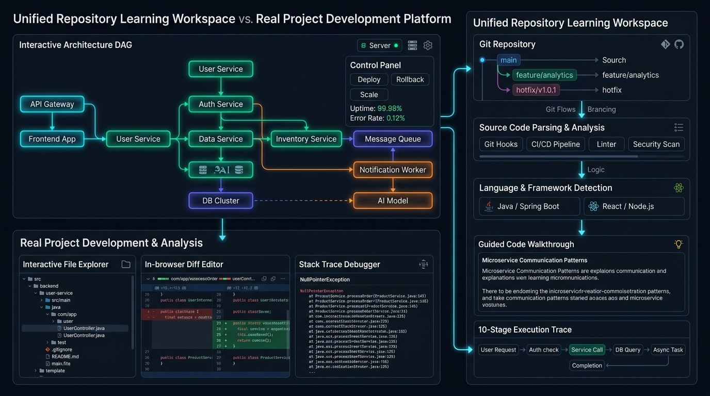

[](https://pradeeptalari.me/projects/)
[](https://pradeeptalari.me/tools/repo-learning/)

# Unified Repository Learning Workspace & Real Project Development Platform

[](https://github.com/Pradeeptalari14/tp-repo-learning/actions/workflows/ci.yml)
[](LICENSE)
[](docker-compose.yml)
[](main.py)

> **Interactive Studio Workspace**: [Talari Pradeep Repository Workspace](https://pradeeptalari.com/tools/repo-learning/)  
> **Engineering Guide**: [Repository-Based Learning & Production Guide](https://pradeeptalari.com/tools/repo-learning/learn.html)

---

## 🏛️ Overview

The **Unified Repository Learning Workspace** bridges the gap between high-level architectural studios and real-world source-code repositories. It empowers developers and students to understand production codebases, trace architectural execution paths, follow structured 10-point courses, launch local multi-container setups, and debug stack traces with precision.



---

## 🚀 Core Features

### 1. Repository Discovery & Import
- **Preset Repositories**: Instant one-click exploration of production repositories:
  - `tp-backend-ecosystem`: Full-stack microservices (FastAPI, Express WS, Go, Redis, Celery, Postgres).
  - `tp-semgrep-ast-guardrails`: Application security AST rules, Python/Go/JS SAST policies.
  - `tp-sigstore-cosign-slsa`: Supply chain security, SLSA Level 3, keyless container signing.
  - `tp-boundary-zerotrust`: HashiCorp Boundary infrastructure access, OIDC.
  - `tp-sbom-cyclonedx-governance`: Software Bill of Materials, CycloneDX 1.5 JSON, Grype scanner.
  - `tp-owasp-llm-agent-shield`: LLM guardrails, dual-pass prompt injection defense.
- **Dynamic Imports**: Import public GitHub repositories with branch and commit SHA tracking.

### 2. Interactive Codebase Understanding & DAG
- Live Directed Acyclic Graph (DAG) visualizing Frontend, Gateway, Microservices, Caches, Databases, and Queues.
- Real-time 10-stage execution path tracer stepping through routes, queries, and worker tasks with latency profiles.

### 3. 10-Point Repository Courses
Each lesson is derived directly from actual project source code:
1. Learning objectives & prerequisites
2. Core concept explanation
3. Relevant repository source files
4. Architecture diagram & trace
5. Guided code walkthrough
6. Hands-on coding exercise
7. Expected results & troubleshooting tips
8. Practical assessment quiz
9. Completed exercise review diff
10. Recommended next lesson

### 4. One-Click Development Setup
- Automated environment validation and prerequisites checklist.
- Sanitized `.env.example` template without exposing secrets.
- Docker Compose launcher and health endpoint check (`GET /health`).

### 5. In-Browser Diff & Stack Trace Workbench
- Side-by-side patch diff viewer before committing changes.
- Automated Stack Trace Diagnostician: Pinpoints exact file and line number from runtime exceptions.

### 6. Git & PR Workflow
- Branch creation, commit reviews, and simulated pull request creation with automated CI status checks.

---

## 🏃 Running the Verification Pipeline

```bash
# Clone the repository
git clone https://github.com/Pradeeptalari14/tp-repo-learning.git
cd tp-repo-learning

# Run the validation script
bash scripts/validate.sh
```

---

## 🔗 Connected Engineering Studios

This repository connects directly into Talari Pradeep's specialized cloud studios:
- [Backend Ecosystem Studio](https://pradeeptalari.com/tools/backend-ecosystem/) — Multi-stack microservices & lifecycle simulator.
- [NGINX Configurator](https://pradeeptalari.com/tools/nginx-config/) — SSL termination & upstream reverse proxying.
- [Redis Cache Studio](https://pradeeptalari.com/tools/redis-cesc/) — Sub-2ms caching and distributed locks.
- [Event-Driven SRE Studio](https://pradeeptalari.com/tools/event-sre/) — Queue consumers & DLQ triage.
- [Semgrep AST Guardrails](https://pradeeptalari.com/tools/semgrep-ast-guardrails/) — Semantic SAST security policies.
- [Sigstore Cosign Studio](https://pradeeptalari.com/tools/sigstore-cosign-slsa/) — Keyless container signing.
- [Boundary Zero-Trust Studio](https://pradeeptalari.com/tools/hashicorp-boundary-zerotrust/) — Identity-based remote access.

---

## 📜 License & Author

- **Author**: Talari Pradeep
- **License**: [MIT](LICENSE)

---
*Synchronized with [Unified Repository Learning Workspace & Real Project Studio Studio](https://pradeeptalari.me/tools/repo-learning/) & [Repository Learning DAG](https://pradeeptalari.me/tools/repo-learning/) — [Talari Pradeep Portfolio](https://pradeeptalari.me)*
